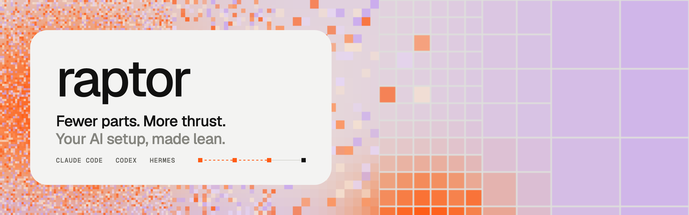
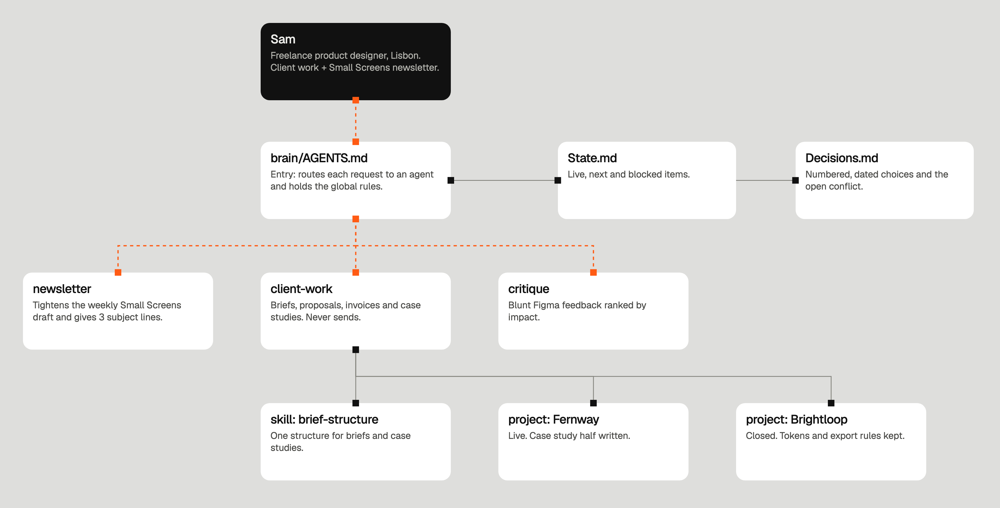

<p align="center">
  
</p>

<p align="center">
  <strong>Your AI already knows how you work. Raptor turns that into an operation, then keeps it lean.</strong>
  <br>
  One skill for Claude Code, Codex, Hermes, or any agent that loads skills. Plain markdown, no code.
</p>

<p align="center">
  <a href="LICENSE"></a>
  
  
</p>

<p align="center">
  <a href="#install">Install</a> &bull;
  <a href="#use-it">Use it</a> &bull;
  <a href="#see-it-work">See it work</a> &bull;
  <a href="#build-once">Build</a> &bull;
  <a href="#trim-every-week">Trim</a>
</p>

<br>

**① Build, once: everything your AI knows about you, organized.**
Raptor reads your agent's memory and rules, your session history and your chat exports, and builds one entry, an agent for each thing you actually do, skills for what you repeat, state, decisions and a map. You approve one 10-line plan.

**② Trim, every week: rules only grow, until you cut them.**
It measures what every chat loads before you type, clears the junk, finds the correction you gave twice and the rule nobody follows, and hands you at most 5 cuts. You answer `apply 1, 3`.

<p align="center">
  
  <br>
  <sub>A real build run: <a href="examples/sam">Sam</a>'s scattered setup, after one <code>run raptor</code>.</sub>
</p>

<br>

## Install

**Claude Code**

```bash
/plugin marketplace add defiphill/raptor
/plugin install raptor@raptor
```

**Codex**

```bash
codex plugin marketplace add defiphill/raptor
codex plugin add raptor@raptor
```

**Any other agent** (Hermes, Cursor, Gemini CLI, opencode and more), via the [`skills`](https://github.com/vercel-labs/skills) CLI:

```bash
npx skills add https://github.com/defiphill/raptor --skill raptor
```

<details>
<summary>No installer? Copy the folder.</summary>

```bash
git clone https://github.com/defiphill/raptor /tmp/raptor
cp -R /tmp/raptor/skills/raptor ~/.claude/skills/raptor                 # Claude Code
cp -R /tmp/raptor/skills/raptor ~/.codex/skills/raptor                  # Codex
cp -R /tmp/raptor/skills/raptor ~/.hermes/skills/productivity/raptor    # Hermes
```

Or point any agent at `skills/raptor/SKILL.md` and say "run this here".
</details>

## Use it

Open your agent in the folder you want organized and say:

```text
run raptor
```

It picks the mode. No entry that routes to agents yet: **build**. Already have one: **trim**. Run it again every week; Friday works.

No files at all, only a chat app? Raptor hands you one prompt to paste there:

> List everything you know about me: who I am, my work and projects, the tools I use, how I like things done, the corrections I gave you more than once, and what I keep asking you to do.

Paste the answer back and build starts from that.

## See it work

[`examples/sam`](examples/sam) is a real run. Sam is fictional; everything else is what raptor produced.

**Before:** a 194-word `CLAUDE.md`, a memory dump and loose notes.

| File | Problem |
|---|---|
| `CLAUDE.md` | "be concise" 3 times, the em-dash rule twice |
| `CLAUDE.md` | rate €2,800, but it's been €3,200 since March |
| `CLAUDE.md` | logs every task to Linear, dropped in August |
| `CLAUDE.md` | rules for Brightloop, a project that shipped |
| `memory-dump.md` | 4 corrections given more than once, written nowhere |
| `notes/todo.md` | open work no agent owns |
| `notes/` | a duplicate brief, an empty `.bak`, an empty archive folder |

- **After:** [`brain/`](examples/sam/after/brain) with an entry, three agents with contracts, memory and corrections, one skill, two projects, state, decisions and the map above. The old `CLAUDE.md` is one line: `@brain/AGENTS.md`.
- **Settled on its own:** the old rate, the dropped tool, the shipped project, spelling rules that depend on the audience.
- **Asked Sam:** one thing no date or scope settled (900 vs 1,000 words).
- **Proof:** a fresh agent got only the entry file and four real requests: 4 of 4 reached the right agent with the right rules, and it caught one thing the build got wrong. [Result](examples/sam/after/PROOF.md).

## Build, once

1. **Gathers** memory and rules files, session history (Claude Code, Codex, Hermes), ChatGPT or Claude.ai exports, the folder itself. Newest first; it stops when history stops adding anything.
2. **Extracts** who you are, each recurring job, every rule (including the ones you only ever said as a correction), methods you repeat, and open work. Dated changes and dead tools are settled; only true conflicts reach you.
3. **Plans** in 10 lines: agents, skills, what moves where, every file it will touch outside the new folder. You say go.
4. **Builds** the shape below, splits mixed notes by function, fixes every reference, and bridges each agent you use (`CLAUDE.md` → `@AGENTS.md`).
5. **Proves** it: an agent given only the new entry must route real past requests to the right agent with the right rules.

```
brain/
  AGENTS.md          who you are, which agent handles what, global rules once
  Map.canvas         the whole operation on one screen (Obsidian, optional)
  State.md           live, blocked, next
  Decisions.md       numbered, dated
  agents/<name>/
    AGENTS.md        contract: input, output, checks that mean done, what not to touch
    memory.md        every open item it owns
    cases.md         every correction you gave it, so you never give it twice
    skills/
  projects/<name>.md handoff in 30 lines or less
```

Open `brain/` in [Obsidian](https://obsidian.md) and it's a second brain with a live map. Skip Obsidian and it still works: it's all markdown.

The shape comes from the author's own setup: one entry and four agents, in daily use since October 2026.

## Trim, every week

1. **Measures** every word loaded at chat start and names the file that grew this week.
2. **Fixes on its own:** handoffs back to live work and next step, duplicate and empty files to the Trash, dead paths repaired.
3. **Checks** last week's sessions: the correction given twice, the wrong skill, the method redone by hand, the rule its own evidence says is broken.
4. **Proposes** at most 5 cuts, each with file, current text, new text and evidence.

```
2. AGENTS.md, "Model rotation" (212 words)
   Current: "Rotate between models every 3 tasks to balance quota..."
   New:     (remove)
   Why:     that model was dropped weeks ago; the subagent log
            shows zero rotations in 30 days (logs/subagents.log)
```

A real run on the author's setup took startup reading from 8,274 to 6,866 words by removing rules for a retired agent, an old model-rotation scheme and a policy nothing used. Tokens were never the point: an agent that reads a dead rule can follow it.

## Three promises

- **Nothing lost.** No rule, decision, open task or unique fact is dropped without proof it's dead. Build snapshots first; removals go to the Trash, never `rm`, and every path is listed.
- **No new power.** Raptor never grants a permission to pay, send, publish or touch production. In a git repo it never commits or pushes.
- **You decide.** Build waits for one OK on the plan. Trim never edits a rule without your `apply`.

## What's in this repo

- `skills/raptor/`: the skill (`SKILL.md`) and its references: `build.md`, `trim.md`, `shape.md`
- `examples/sam/`: a full build run, before and after
- `.claude-plugin/`, `.codex-plugin/`: plugin manifests for Claude Code and Codex
- `.claude/skills/`, `.agents/skills/`: symlinks so agents discover the skill in place

## License

[MIT](LICENSE)
